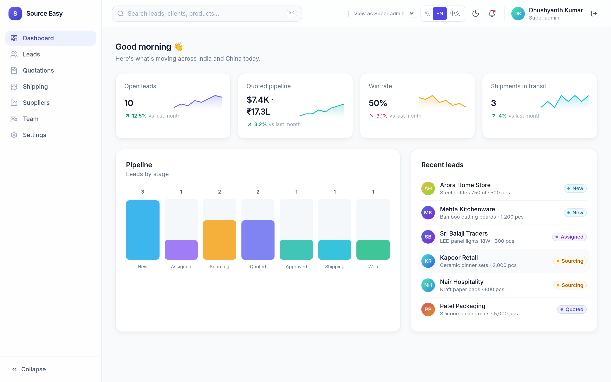

# Source Easy

A sourcing CRM for an India ↔ China trading business. India staff capture **leads** from customers. China staff turn them into **sourcing requests**, find **suppliers** and post **quotations** in RMB/USD. India converts the quotes to INR, shares a PDF quote on WhatsApp, records the **client approval**, and both offices track the **shipping order**.

The spec is in [BLUEPRINT.md](BLUEPRINT.md) and the decisions are in [QUESTIONS.md](QUESTIONS.md).

```
             ┌──────────── Server 1 ────────────┐   ┌──────── Server 2 ────────┐
Web + app ───┤ Caddy → Source Easy server (REST) │
 (Flutter)   │   └→ Twenty (internal only)       │   │ Caddy → Chatwoot (chat)  │
             │         Postgres 16 · Redis       │   │  Postgres(pgvector)·Redis│
             └───────────────┬──────────────────┘   └────────────┬─────────────┘
                             │ nightly pg_dump + rsync            │
                             ▼                                    ▼
                     ┌──────────── Server 3 (storage) ────────────────┐
                     │ rotation 7 daily / 4 weekly · restore.sh       │
                     │ hourly healthcheck → email · backup browser    │
                     └────────────────────────────────────────────────┘
```

| Folder | What's in it |
|---|---|
| `server/` | Source Easy server (Fastify/TypeScript): login, roles, filtered REST API, serves `web/` |
| `infra/server1-twenty/` | Docker Compose for Caddy (TLS, the only public entry), the Source Easy server, and internal Twenty (server and worker), Postgres and Redis |
| `infra/server2-chatwoot/` | Docker Compose for Chatwoot (rails and sidekiq), pgvector Postgres, Redis and Caddy |
| `infra/app-servers/` | `nightly-dump.sh`, which runs on servers 1 and 2 |
| `infra/server3-storage/` | `rotate.sh`, `restore.sh`, `healthcheck.sh`, a crontab, and the `backup-browser/` web page |
| `twenty-setup/` | A metadata API script that creates the custom objects |
| `mobile/` | The Flutter Android app (Material 3) |

No secrets are in git. Every `*.example` file has to be copied and filled in on the server.

---

## 1. Server 1: Source Easy + Twenty (VPS)

Only Caddy is public (80/443). It proxies everything to the **Source Easy server** (`api` service, :8080), which serves
the web app and the REST API used by web and Android. Twenty, Postgres and Redis have no public ports; the server
talks to Twenty on the docker network (`http://server:3000`) with an API key that never leaves the VPS.

```bash
cd infra/server1-twenty
cp .env.example .env
#   openssl rand -base64 32   → APP_SECRET, PG_DATABASE_PASSWORD
#   openssl rand -base64 48   → JWT_SECRET
#   set SUPER_ADMIN_EMAIL / SUPER_ADMIN_PASSWORD (min 10 chars)
docker compose up -d server worker db redis
docker compose logs -f server      # wait for "Nest application successfully started"
```

Twenty admin (one-time setup and object maintenance) goes through an SSH tunnel, never the internet:

```bash
ssh -L 3000:localhost:3000 root@<vps>     # then open http://localhost:3000
```

Create the workspace and first Twenty user, run the object setup (section 3), then create an API key under
**Settings → APIs & Webhooks**, put it in `.env` as `TWENTY_API_KEY`, and start the rest:

```bash
docker compose up -d --build api caddy    # DNS for DOMAIN must point at the VPS for the TLS certificate
curl https://sourceeasy.in/api/health       # {"ok":true}
```

The super admin from `.env` is created on first boot (only if missing). Sign in at `https://sourceeasy.in`, change the password
(`POST /api/me/password`), then add staff under **Team**. Updating: `git pull && docker compose up -d --build api`.

Postgres listens on `127.0.0.1` only. It is reached for dumps through `docker compose exec`. App users live in SQLite in the
`api-data` volume (`/data/users.db`); include it in backups (`docker compose cp api:/data/users.db .`).

### Local development

```bash
# 1. Twenty on http://localhost:3000 (e.g. this compose file with only server/worker/db/redis, or Twenty's own docker setup)
# 2. Server
cd server && npm ci
TWENTY_URL=http://localhost:3000 TWENTY_API_KEY=... JWT_SECRET=$(openssl rand -hex 32) \
SUPER_ADMIN_EMAIL=me@example.com SUPER_ADMIN_PASSWORD=change-me-now npm run dev    # :8080
# 3. Web (proxies /api to :8080)
cd web && npm ci && npm run dev    # http://localhost:5173
# No Twenty? Run the server against mocked Twenty data:
cd server && npx tsx scripts/demo-server.ts   # :8099, users china@/india@/indiaadmin@/super@sourceeasy.in, password demo-password-1
# Tests
cd server && npm test
```

Android against a local server: set the server URL on the sign-in screen to `http://<your-lan-ip>:8080`.

### Roles

Users are created in the Source Easy server (super admin from env, then **Team** page or `POST /api/users`), stored in SQLite
with bcrypt hashes; sessions are JWTs (default 12 h, revoked on password reset or disable). Creating a user also creates/updates
the matching Twenty **Team Member** (same email) so records can be assigned to them.

| Role | Sees |
|---|---|
| `INDIA_STAFF` | Customers and leads, and client prices in the currency they were entered. No supplier identity or raw supplier costs. |
| `CHINA_STAFF` | Suppliers and supplier costs (in their entered currency). Only leads assigned to China, with customer name/contact removed. |
| `INDIA_ADMIN` / `CHINA_ADMIN` | Their own side, plus creating users / resetting passwords for their side. |
| `SUPER_ADMIN` | Everything, including backup links. |

**This separation is enforced in the server**: records and fields a role may not see are removed before the response leaves
the VPS, and writes are checked per role and field (`server/src/policy.ts`, tested in `server/test/roles.test.ts`). Because
Twenty is not exposed, staff have no other way to reach the data. Keep the number of people with SSH/Twenty admin access small.

| Endpoint | |
|---|---|
| `POST /api/auth/login` `{email,password}` | → `{token,user}` (5 failures → 10 min lockout per email+IP) |
| `GET /api/me`, `POST /api/me/password` | current user / change own password |
| `GET /api/records/:plural?field=value` | `leads, sourcingRequests, suppliers, quotations, clientApprovals, shippingOrders, teamMembers` (filtered) |
| `GET/PATCH /api/records/:plural/:id`, `POST /api/records/:plural` | role-checked read/write |
| `GET/POST /api/users`, `PATCH /api/users/:id`, `POST /api/users/:id/password` | admins, own side only |
| `GET /api/backups` | super admin only (`BACKUP_LINKS`) |

### Currencies and language

There is **no currency conversion**. Each amount is stored and shown in the currency it was entered in: USD (`$`), RMB/CNY (`¥`) or INR (`₹`).
Every price form (web and Android) has a currency picker. A quotation has the supplier cost (`unitCost`, `totalCost`, `currency`, China side only)
and the client price (`clientUnitPrice`, `clientCurrency`, India side). Totals are never summed across currencies.

The UI is available in English and Simplified Chinese (switch in the top-right corner, also on sign-in). The choice is saved on the device
and, when signed in, on the user (`PATCH /api/me {language}`). Data values (names, products, notes) are not translated.

---

## 4. Backups (server 3)

### On servers 1 and 2

Copy `infra/app-servers/` to the server, then:

```bash
cp backup.env.example backup.env        # APP=twenty|chatwoot, compose dir, storage host, ssh key
crontab -e
#   30 2 * * * /opt/source-easy/app-servers/nightly-dump.sh >> /var/log/se-backup.log 2>&1
```

The script does the following, in order:

1. Runs `pg_dump` and compresses the output with gzip.
2. Checks the archive with `gzip -t`.
3. Uses `rsync` to copy it to `storage:/srv/backups/incoming/<app>/`.
4. Triggers `rotate.sh` on the storage server.

Use a dedicated SSH key, and restrict it in `authorized_keys` on server 3.

### On server 3

```bash
cd infra/server3-storage
cp health.env.example health.env       # URLs to check, ALERT_EMAIL, thresholds
cp restore.env.example restore.env
crontab crontab.example                # hourly healthcheck (rotation is triggered by the app servers)
```

- **Rotation** keeps 7 daily dumps, plus 4 weekly dumps (Sunday copies).
- **Health check** (hourly) checks HTTP on all three servers, free disk space, and the age of the newest backup. It emails `ALERT_EMAIL` through `sendmail` when a check fails, so install `msmtp-mta` or `postfix`.
- **Restore** is one command:
  ```bash
  ./restore.sh twenty daily/twenty-2026-10-30.sql.gz
  ```
  You must re-type the filename to confirm. The script stops the app containers, loads the dump through ssh/psql, and then starts the containers again.

### Backup browser

`backup-browser/app.py` is a single-file Python web page that uses the standard library only.

- Only admin roles can sign in. **Only `super_admin` sees download links.** `/download` also checks the role and only serves files from a whitelist.
- Setup:
  ```bash
  python3 app.py hash-password             # make password hashes for users.json
  cp users.example.json users.json && $EDITOR users.json
  sudo cp source-easy-backups.service /etc/systemd/system/ && sudo systemctl enable --now source-easy-backups
  ```
  Put it behind Caddy for TLS (see `Caddyfile.example`).
- Tests: `python3 -m unittest test_app.py`

---

## 5. Mobile app (Android, sideloaded)

The app is Flutter 3.35 with Material 3 and requires Android 6.0 (API 23) or newer.

```bash
cd mobile
flutter pub get
flutter analyze
flutter test
flutter build apk --release      # → build/app/outputs/flutter-apk/app-release.apk
```

To install it, run `adb install app-release.apk`, or send the APK to the phone and allow "install unknown apps".

**Signing.** If there is no keystore, the release build is signed with the debug key. That works for sideloading, but you can't upgrade over it with a differently signed build later. For real distribution, create a key once and keep it **out of git**:

```bash
keytool -genkey -v -keystore ~/source-easy.jks -keyalg RSA -keysize 2048 -validity 10000 -alias source-easy
cat > android/app/key.properties <<P
storeFile=/home/you/source-easy.jks
storePassword=...
keyAlias=source-easy
keyPassword=...
P
```

**First run.** On the sign-in screen, the server URL defaults to `https://sourceeasy.in`; enter the email and password your admin created. Then enter the Chatwoot details under *Settings → Chatwoot*. The tokens are kept in Android encrypted storage.

### Screens

- Dashboard: pipeline counts by stage
- Leads: list, detail with timeline, and create
- Sourcing request form
- Quotation:
  - RMB / USD / INR toggle, limited by role
  - The client price is set with its own currency picker (USD / RMB / INR)
  - **PDF quote → Android share sheet → WhatsApp**, with no WhatsApp API
- Client approval: accepting a quote creates a shipping order
- Shipping tracker: stage stepper, map of the current location, and editing for China
- Chat over the Chatwoot REST API: one conversation per sourcing request, polled every 10 s
- Settings:
  - profile and role
  - sync queue with "Sync now"
  - language (English / 简体中文; also top-right on every screen)
  - Chatwoot configuration
  - backups note (super admin)
  - sign out

### Offline

- Reads are cached in SQLite and served from the cache when there's no connection.
- Writes made offline go into a SQLite queue and are marked "pending".
- The queue replays in order when the connection returns, or when you tap "Sync now".
- Each create carries a `clientRef`. If a replay finds a record with that ref already exists, it skips the create, so nothing is duplicated.

### Code layout

```
lib/core/       roles.dart (Role, Permissions), currency.dart (USD/RMB/INR formatting, no conversion)
lib/l10n/       app_en.arb, app_zh.arb (gen-l10n; English / 简体中文)
lib/data/api/   twenty_client.dart (GraphQL), twenty_auth.dart, chatwoot_client.dart
lib/data/       models/, offline/offline_queue.dart, repository.dart (the single data API for the UI)
lib/services/   session.dart (login, config, sync), quote_pdf.dart
lib/ui/         home_shell.dart, screens/, widgets/
```

## 6. Web dashboard

`web/` is a React/Tailwind dashboard with a collapsible sidebar, ⌘K search, KPI cards with sparklines, a drag-and-drop lead pipeline, data tables with sticky headers and slide-over details, and light/dark mode. It talks only to the Source Easy server (same origin), and its navigation follows the signed-in role. Role views: [China quotations](docs/screenshots/role-china-quotations.png) vs [India quotations](docs/screenshots/role-india-quotations.png), [login](docs/screenshots/login-server.png). Setup is in [web/README.md](web/README.md), and screenshots are in [docs/screenshots](docs/screenshots).



## Known limitations / TODO

- The server's Twenty REST calls follow `twenty-setup/schema.json` and Twenty's REST conventions, but are only tested against a mocked Twenty.
- `SOURCE_EASY_WEBHOOK_URL` (Chatwoot → `/webhooks/chatwoot`) has no handler in the server yet.
- Chat in the mobile app still talks to Chatwoot directly with the user's Chatwoot token.
- A sourcing request created offline can't have suppliers attached until it has synced.
- Push notifications (FCM) and the business-card scanner are not built yet.
- Chat polls every 10 s instead of using websockets. "My" messages are matched by sender name.
- The quote PDF uses the built-in Helvetica font, which has no ₹ glyph, so amounts are printed as "INR 1,234.00". To show ₹, bundle a TTF such as Noto Sans.
- Nothing has been tested against live Twenty or Chatwoot servers yet. The automated tests use mocked HTTP.
